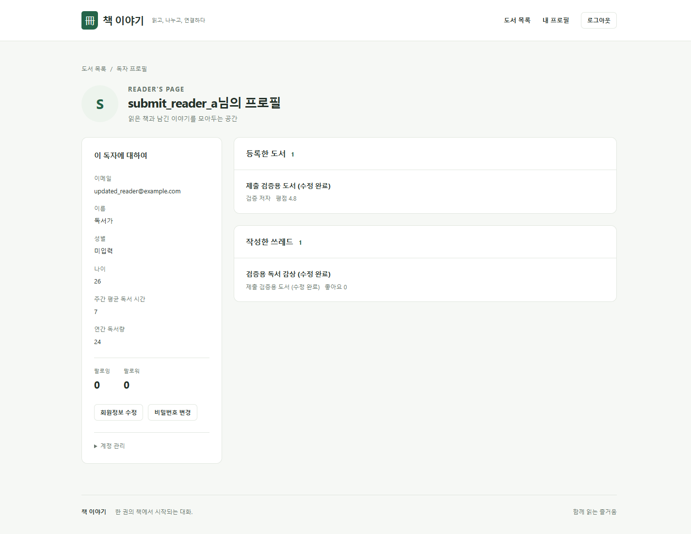
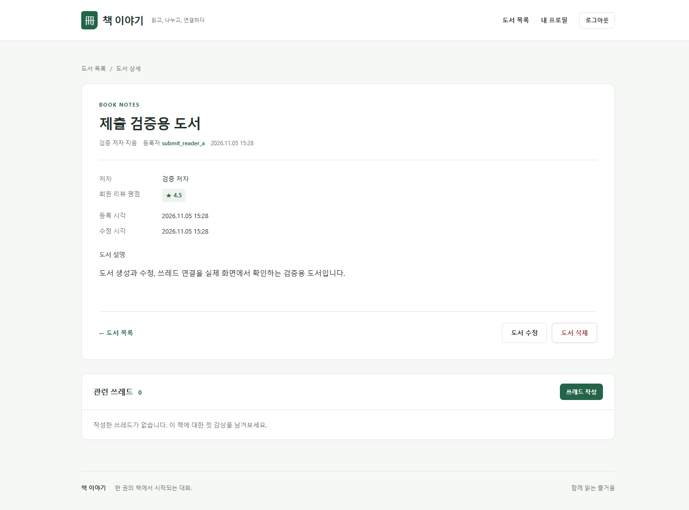
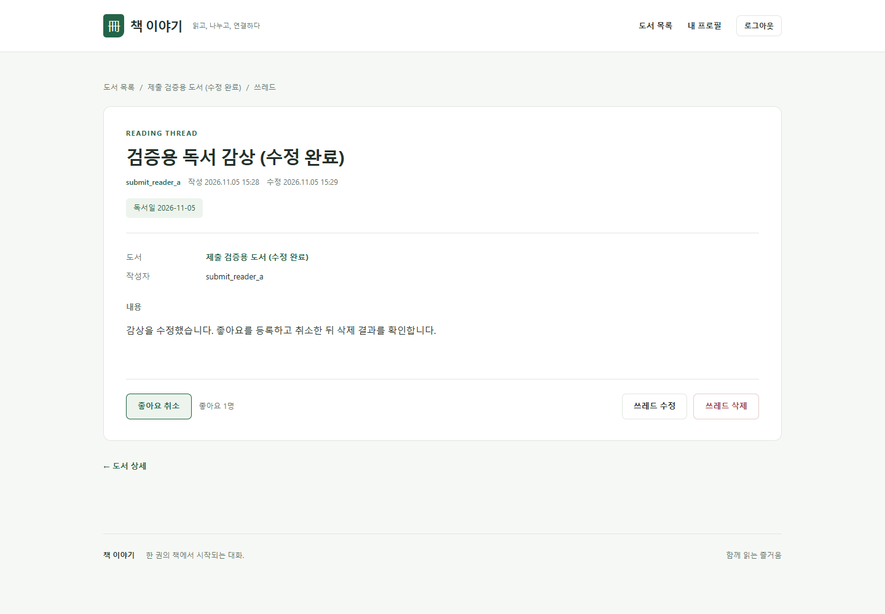
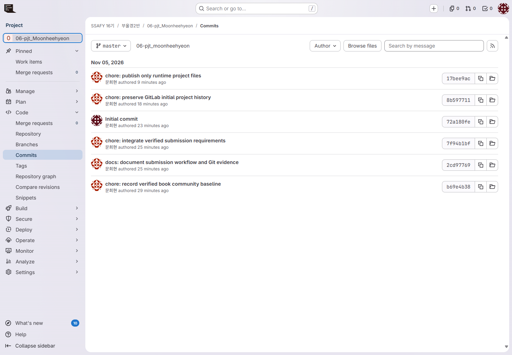

# 책 이야기

책 정보와 평점을 등록하고 독서 감상을 나누는 Django 도서 커뮤니티입니다. 회원가입 후 도서를 소개하고, 감상 글을 작성하며 다른 독자와 교류할 수 있습니다.

## 주요 기능

- 회원가입·로그인, 회원정보·비밀번호 변경, 회원 탈퇴
- 프로필 이미지와 작성한 도서·감상 글 조회, 팔로우
- 도서와 감상 글 등록·조회·수정·삭제
- 감상 글 좋아요와 취소

## 실행 방법

필수 라이브러리는 Django 5.2.18과 Bootstrap 5.3.8입니다. Bootstrap CSS·JavaScript와 MIT 라이선스는 `static/vendor/bootstrap/`에 포함되어 화면 실행 시 외부 CDN 연결이 필요하지 않습니다.

Python 3.11 또는 3.12를 설치하세요. 명세의 참고 환경은 Python 3.11이며, 실제 실행 검증은 Python 3.12에서 수행했습니다. Windows PowerShell에서 저장소를 내려받은 뒤 `manage.py`가 있는 폴더에서 실행하세요.

```powershell
python -m venv .venv
.\.venv\Scripts\python.exe -m pip install -r requirements.txt
.\.venv\Scripts\python.exe manage.py migrate
.\.venv\Scripts\python.exe manage.py runserver
```

브라우저에서 http://127.0.0.1:8000/ 에 접속하세요. 처음 실행하면 데이터베이스와 도서 목록이 비어 있습니다. 회원가입 후 도서와 감상 글을 직접 등록할 수 있습니다.

## 프로젝트 구조

```text
accounts/       회원·인증·프로필·팔로우
books/          도서·감상 글·좋아요
mypjt/          Django 설정과 공통 URL
templates/      공통 화면과 폼
static/css/     화면 스타일
static/vendor/  Bootstrap 5.3.8과 라이선스
manage.py       Django 실행 명령
requirements.txt 패키지 버전
screenshots/    필수 요구사항 실행 결과
```

## 필수 요구사항과 실행 결과

2026-11-05 실제 Django 화면에서 회원가입·도서 및 쓰레드 작성·수정·삭제·팔로우·좋아요를 수행한 캡처입니다. 화면 속 계정과 도서는 검증용 예시이며, 저장소에는 개인 데이터베이스와 업로드 파일을 포함하지 않습니다. 따라서 새로 설치하면 아래 예시 데이터가 자동으로 나타나지는 않습니다.

| 요구사항 | 구현 및 확인 위치 |
| --- | --- |
| F601 프로젝트·앱·공통 내비게이션 | [설정](mypjt/settings.py), [공통 화면](templates/base.html): 로그인 시 공통 헤더의 도서 목록·도서 등록·내 프로필·로그아웃 제공 |
| F602 사용자 모델·팔로우 관계 | [User 모델](accounts/models.py), [초기 migration](accounts/migrations/0001_initial.py) |
| F603 사용자 폼 | [회원가입·회원정보 수정 폼](accounts/forms.py), [인증·비밀번호 변경 처리](accounts/views.py) |
| F604 도서 모델 | [Book 모델](books/models.py) |
| F605 쓰레드 모델·도서/작성자/좋아요 관계 | [Thread 모델](books/models.py) |
| F606 도서·쓰레드 ModelForm | [BookForm·ThreadForm](books/forms.py), [검증 후 저장 처리](books/views.py) |
| F607 로그인 | [로그인 후 메인](screenshots/f607_login_result_f615_index.png) |
| F608 로그아웃 | [로그아웃 후 메인](screenshots/f608_logout_result.png) |
| F609 회원가입 | [입력 폼](screenshots/f609_signup_form.png), [가입 결과](screenshots/f609_signup_result_f610_profile.png) |
| F610 프로필 | [회원 정보·작성 도서·쓰레드](screenshots/f610_profile_with_book_thread.png) |
| F611 팔로우 | [팔로우 후](screenshots/f611_follow_result.png), [취소 후](screenshots/f611_unfollow_result.png) |
| F612 회원정보 수정 | [수정 전](screenshots/f612_update_before.png), [수정 후](screenshots/f612_update_result.png) |
| F613 회원탈퇴 | [탈퇴 전](screenshots/f613_account_delete_before.png), [탈퇴 후](screenshots/f613_account_delete_result.png), [삭제 계정 로그인 거부](screenshots/f613_deleted_account_login_denied.png) |
| F614 비밀번호 변경 | [입력 폼](screenshots/f614_password_form.png), [변경 후 로그인 유지](screenshots/f614_password_result_session_kept.png) |
| F615 도서 목록 | [빈 목록](screenshots/f607_login_result_f615_index.png), [등록 후 목록](screenshots/f615_index_with_book.png) |
| F616 도서 생성 | [입력 폼](screenshots/f616_book_create_form.png), [생성 결과](screenshots/f616_create_result_f617_book_detail.png) |
| F617 도서 상세 | [도서 정보](screenshots/f616_create_result_f617_book_detail.png) |
| F618 도서 수정 | [수정 전](screenshots/f618_book_update_before.png), [수정 후](screenshots/f618_book_update_result.png) |
| F619 도서 삭제 | [삭제 전](screenshots/f619_book_delete_before.png), [삭제 후 목록](screenshots/f619_book_delete_result.png) |
| F620 쓰레드 생성 | [입력 폼](screenshots/f620_thread_create_form.png), [생성 결과](screenshots/f620_create_result_f621_thread_detail.png) |
| F621 쓰레드 상세 | [도서·작성자·독서일·본문](screenshots/f620_create_result_f621_thread_detail.png) |
| F622 쓰레드 수정 | [수정 전](screenshots/f622_thread_update_before.png), [수정 후](screenshots/f622_thread_update_result.png) |
| F623 쓰레드 삭제 | [삭제 전](screenshots/f623_thread_delete_before.png), [삭제 후 도서 상세](screenshots/f623_thread_delete_result.png) |
| F624 좋아요 | [등록 후](screenshots/f624_like_result.png), [취소 후](screenshots/f624_unlike_result.png) |
| NF602 앱별 URL 구성·이름 | [accounts URL](accounts/urls.py), [books URL](books/urls.py), 템플릿의 `` 참조 |
| NF603 허용 HTTP Method·권한 | [accounts 뷰](accounts/views.py), [books 뷰](books/views.py)의 Method·로그인·작성자 검사 |

회원 프로필과 작성 내역:



도서 생성 후 상세:



쓰레드 좋아요 등록:



모델·폼·URL·HTTP Method는 화면만으로 확인할 수 없어 위 소스를 함께 연결했습니다. 기존 통합 검증에서는 입력 오류 거부, 작성자 외 수정·삭제 거부, 관계 필드 주입 차단, 비밀번호 변경 후 세션 유지·새 비밀번호 로그인, CSRF 및 404·405 응답을 확인했습니다.

Bootstrap 5.3 적용 후에도 [데스크톱 도서 상세](screenshots/bootstrap_desktop_book.png)와 [모바일 회원가입](screenshots/bootstrap_mobile_signup.png)을 실제 브라우저에서 확인했습니다. Bootstrap CSS·JavaScript는 프로젝트에 포함되어 실행 시 외부 CDN에 접속하지 않습니다.

## Git 운영 및 점검 — NF601

기능 구현 후 기존 완성 코드를 기준 커밋으로 기록하고 제출 보완부터 아래 원칙을 적용했습니다. 초기 개발 때의 팀 합의나 기능별 개발 커밋 기록은 남아 있지 않으므로 이를 소급해서 주장하지 않습니다.

- 작업 목적에 따라 `docs/<작업명>`, `fix/<작업명>`, `feat/<작업명>` 브랜치를 만들고, 작업 및 검증이 끝나면 `main`에 통합합니다. `master`는 GitLab 제출 기본 브랜치입니다.
- 커밋 메시지는 `docs:`, `fix:`, `feat:`, `chore:`로 변경 목적을 드러내고, 하나의 목적에 해당하는 변경과 검증이 끝난 시점에 기록합니다.
- 통합 전에 변경 파일과 실행 결과를 확인합니다. 제출에는 실행 소스·README·필수 증거만 포함하고 가상환경·개인 DB·업로드·개발용 문서는 제외합니다.
- 기존 원격 이력을 보존하며 강제 덮어쓰기를 하지 않습니다. 브랜치 문제는 원인과 처리 결과를 기록합니다.

실제로 생성한 브랜치의 용도는 다음과 같습니다.

| 브랜치 | 실제 용도 및 상태 |
| --- | --- |
| `main` | 검증한 변경을 통합하는 로컬·원격 브랜치 |
| `master` | GitLab 기본 제출 브랜치. 통합본을 반영 |
| `docs/submission-requirements` | Git 운영 원칙·제출 증거를 처음 보완한 브랜치. `7f94b1b`로 통합 후 원격에서 삭제하고 로컬에 보관 |
| `docs/gitlab-submission` | 실행에 필요한 파일 위주로 제출 구성을 정리한 작업 브랜치. `17bee9a`에 해당 변경을 기록하고 `main`에 반영 |
| `docs/mandatory-submission-evidence` | 필수 라이브러리·공통 메뉴·실행 캡처와 README를 보완한 작업 브랜치 |

실제 기록은 `b69e4b3`(기존 완성 코드 기준), `2cd9776`(제출 문서 보완), `7f94b1b`(브랜치 통합), `8b59771`(GitLab 초기 이력 보존), `17bee9a`(실행 소스 중심 정리) 순서로 확인할 수 있습니다. `b69e4b3`은 이전 기능 구현 과정을 재현한 커밋이 아닙니다.

문제 분석 및 점검 결과:

- 로컬 프로젝트와 원격 GitLab의 초기 이력이 별개였으므로 기존 원격 `72a180f`를 `8b59771`에서 병합해 보존했습니다.
- 첫 제출 구성에 개발 문서가 포함되어 사용자 요청과 맞지 않았습니다. `17bee9a`에서 실행 파일 중심으로 정리하고 제외 규칙을 추가했습니다. 이후 필수 제출 증거만 `screenshots/`와 README에 보완합니다.
- PDF의 준비사항과 공통 메뉴를 추가 대조하여 Bootstrap 5.3 로컬 파일과 도서 등록 바로가기를 보완했습니다. 통합 테스트와 실제 브라우저·모바일 검증을 다시 수행했습니다.
- 제출 보완용 브랜치의 분기·통합 및 목적이 드러나는 커밋은 실제 이력으로 확인했습니다. 초기부터 원칙이 지켜졌는지는 당시 기록이 없어 입증할 수 없습니다.

[GitLab 실제 커밋 이력](https://lab.ssafy.com/s16/e02/06-pjt_moonheehyeon/-/commits/master)에서 제출 브랜치의 기록을 확인할 수 있습니다. 아래는 해당 GitLab 페이지에 실제 로그인하여 확보한 커밋 화면입니다. 캡처는 이번 제출 증거 추가 커밋 이전의 `17bee9a`까지 표시하며, 이후 최신 이력은 위 링크에서 확인할 수 있습니다.



필수 기능 F601~F624와 NF602·NF603은 소스 대조 및 기존 통합 검증을 통과했습니다. 제출 파일만 별도 폴더에 꺼내 새 데이터베이스 생성 후 서버를 실행하고 메인·로그인·회원가입·CSS 응답도 확인했습니다. 필수 실행 캡처 29장과 GitLab 이력 캡처 1장을 README에 연결했습니다. 초기 팀 합의 및 초기 운영 준수 여부는 당시 기록이 없어 입증할 수 없으며, 위 운영 원칙은 제출 보완부터 실제 적용한 내용입니다.

## 학습 내용

모델 관계와 ModelForm으로 입력을 검증하고, 로그인·작성자 권한 및 요청 방식을 뷰에서 확인하는 방법을 익혔습니다. 공통 템플릿과 이름 있는 URL로 화면을 연결하고 모바일 화면도 함께 점검했습니다.

## 느낀 점

기능을 각각 구현한 뒤에도 회원가입부터 도서 등록·감상 작성까지 이어지는 흐름을 확인해야 했습니다. 정상 입력과 잘못된 요청을 함께 점검하고, 실행 결과를 기준으로 문제를 해결하는 과정이 중요했습니다.
