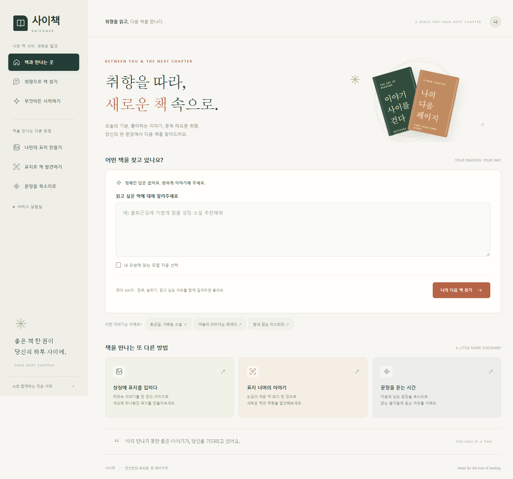

# 사이책 — 07-pjt

취향을 입력하면 도서를 추천하고, 추천 결과에 이어서 질문할 수 있는 AI 독서 서비스입니다.
책 표지 생성·분석, 추천 적합도 평가, 모델 자동 선택, 문장 음성 변환을 함께 제공합니다.



## 제출 자료

프로젝트 명세서 22쪽의 제출 항목에 맞춰 전체 소스 코드, 요구사항별 실행 결과 캡처,
구현 기능·학습 내용·느낀 점을 담은 README를 포함했습니다. GitLab 프로젝트명은 `07-pjt`입니다.

| 자료 | 위치 |
|---|---|
| 전체 구현 소스·마이그레이션·테스트 | [server](server/) |
| 요구사항별 구현·검증·캡처 연결 | [요구사항 충족표](docs/requirements.md) |
| 실제 실행 조건과 확인 결과 | [실행 검증 기록](docs/verification.md) |
| 실행 화면 원본 PNG | [screenshots](docs/screenshots/) |
| 화면을 모은 제출용 보고서 | [실행 결과 보고서 PDF](docs/execution-report.pdf) |
| 자동 검사·테스트 원본 출력 | [test-results](docs/test-results/) |
| 이미지 분석 입력 예시·생성 결과 | [samples](docs/samples/) |

`.env`, 실제 API 키, 가상환경, 개발 중 DB·사용자 업로드, 임시 진단 로그는 제출본에서 제외했습니다.
`docs/samples`의 이미지는 제출 증빙용으로 별도 보관한 예시입니다.

## 구조와 기술

```text
브라우저 → Django :8080 → FastAPI Proxy :8081 → GMS
           검증·화면·DB      Guardrail·모델 호출
```

- Python 3.11 / Django 5.2.6 / FastAPI 0.121.0 / Uvicorn 0.38.0
- SQLite, Django ModelForm, Pillow, requests, python-dotenv
- Django 템플릿·CSS로 화면을 구성하고, JavaScript는 입력 예시·전송 중 표시 등 화면 보조에만 사용합니다.
- 브라우저는 Django로 요청하며 GMS 키는 FastAPI에서만 읽습니다.

```text
07-pjt/
├── README.md
├── .gitignore
├── start_proxy.ps1
├── start_web.ps1
├── server/
│   ├── requirements.txt
│   ├── proxy/         # 모델 호출·Guardrail·응답 변환·단위 테스트
│   └── web/           # Django 모델·뷰·폼·화면·스타일·마이그레이션·테스트
└── docs/              # 실행 보고서·캡처·검증 기록·샘플
```

## 실행 방법

Python **3.11 이상**을 사용합니다. 두 서버는 같은 가상환경을 사용합니다.
프로젝트 최상위 폴더에서 PowerShell을 열고 실행합니다.

```powershell
python --version
python -m venv .venv
.\.venv\Scripts\python.exe -X utf8 -m pip install -r .\server\requirements.txt
Copy-Item .\server\proxy\.env.example .\server\proxy\.env
```

`server/proxy/.env`의 `GMS_KEY`에 실제 발급받은 키를 입력합니다.

```dotenv
GMS_KEY=YOUR_GMS_KEY
GMS_URL=https://gms.ssafy.io/gmsapi/api.openai.com/v1
MODEL_IMAGE=gemini-3.1-flash-lite-image
GMS_IMAGE_URL=https://gms.ssafy.io/gmsapi/generativelanguage.googleapis.com/v1beta
```

첫 번째 PowerShell에서 프록시 서버를 실행합니다.

```powershell
powershell -ExecutionPolicy Bypass -File .\start_proxy.ps1
```

두 번째 PowerShell에서 웹 서버를 실행합니다. 실행 파일이 DB 마이그레이션도 적용합니다.

```powershell
powershell -ExecutionPolicy Bypass -File .\start_web.ps1
```

- 서비스: http://127.0.0.1:8080/
- FastAPI 문서: http://127.0.0.1:8081/docs
- 종료: 각 서버 창에서 `Ctrl + C`

두 창은 사용 중 계속 열어둡니다. 키나 모델 설정을 바꾸면 프록시 서버를 재시작합니다.
개발 도구의 외부 통신 제한으로 `WinError 10013`이 발생하는 경우에는 일반 PowerShell에서 실행합니다.

## 구현 기능

| 요구사항 | 구현 |
|---|---|
| F701 | ModelForm으로 필수 입력·공백·최대 300자 검증 및 정상 입력 저장 |
| F702 | 사용자 취향을 반영한 도서와 추천 이유 생성 |
| F703 | 생성 전에 Guardrail 실행, 부적절한 요청 403, 판단 실패 503 |
| F704 | strict JSON Schema로 텍스트/이미지 요청 분류 |
| F705 | 이미지 생성 결과를 JPEG base64로 정규화해 반환 |
| F706 | GMS HTTP 오류·연결 오류를 503으로 변환, 사용자 안내·키를 가린 로컬 오류 로그 |
| F707 | 업로드한 표지를 base64로 전달해 제목·장르 분석과 유사 도서 추천 |
| F708 | Django에서 경로 결정 → 생성 호출 → 결과 화면 분기를 순차 처리 |
| F709 | 추천 직후 0~100점과 이유를 평가·저장, 평가 장애 시 추천 결과 유지 |
| F710 | 단순 요청 nano / 복잡 요청 mini 자동 선택 및 사용 모델 표시 |
| F711 | nova 음성 MP3를 base64로 전달하고 오디오 플레이어에서 재생 |
| F712 | 생성 이미지를 UUID 이름의 JPEG로 저장하고 `/media/` URL로 제공 |

URL 이름 공간·CSRF·환경변수·API 키 Git 제외를 적용했습니다.
외부 호출 timeout은 FastAPI → GMS 120초, Django → FastAPI 180초입니다.

### 이미지 모델 변경 사항

명세서의 `gpt-image-1-mini`로 실제 요청했을 때 GMS가 모델 미지원 400을 반환했습니다.
사용자가 제공한 GMS 지원 모델 `gemini-3.1-flash-lite-image`로 변경했습니다.
[GMS 공개 가이드](https://gms.ssafy.io/web/public/guide/gemini-3.1-flash-lite-image)의
`/v1beta/interactions` 경로와 `x-goog-api-key` 헤더를 사용합니다.

실제 응답의 `steps → model_output → content → image`에서 이미지를 읽고 Pillow로 JPEG로
변환합니다. Django에 전달하는 `{image_base64}` 계약은 유지하여 저장·화면 표시 기능을 그대로 연결했습니다.
OpenAI 이미지 모델을 지원하는 환경에서는 `MODEL_IMAGE` 설정으로 기존 호출 방식도 사용할 수 있습니다.

### 추가 기능

- **후속 대화:** 첫 추천과 최근 10번의 문답을 문맥으로 전달하여 추가 질문에 답합니다.
- **대화 보관:** 문답을 DB에 저장하고 같은 브라우저 세션에서 다시 열 수 있습니다.
- **접근 제어:** 다른 세션은 대화 내용을 읽거나 질문을 추가할 수 없습니다.
- **실패 복구:** 추가 질문이 거절되거나 연결이 실패해도 기존 대화와 작성한 질문을 유지합니다.
- **새로고침 보호:** 전송 후 대화 주소로 이동해 새로고침으로 요청이 반복되지 않도록 했습니다.
- **화면 개선:** 아이보리·녹색 디자인, 모바일 메뉴, 취향 예시 버튼, 전송 중 표시를 제공합니다.
- **안전한 답변 표시:** 모델이 생성한 HTML은 이스케이프하고 제한된 텍스트 강조만 표시합니다.

## 테스트

```powershell
# server/web 폴더에서
..\..\.venv\Scripts\python.exe manage.py check
..\..\.venv\Scripts\python.exe manage.py makemigrations --check --dry-run
..\..\.venv\Scripts\python.exe manage.py test --verbosity 2

# server/proxy 폴더에서
..\..\.venv\Scripts\python.exe -m unittest discover -s tests -v
```

Django 19개, 프록시 12개로 **총 31개 테스트**가 통과했습니다.
자동 테스트에서는 외부 GMS 호출을 대체합니다. 실제 모델 검증은 별도로 브라우저에서 수행했으며,
텍스트 추천·거절·경로 분류·모델 선택·이미지 생성·분석·미디어 저장·TTS 재생·후속 대화를 확인했습니다.

## 학습 내용

Django는 입력·화면·저장을, FastAPI는 모델 호출·Guardrail을 담당하게 분리하면서
같은 기능도 어느 서버가 책임져야 하는지 명확히 정리할 수 있었습니다.
특히 Guardrail을 화면에서만 검사하면 API를 직접 호출할 때 누락될 수 있어,
각 생성 API 내부에서 먼저 실행하는 구조가 필요했습니다.

분류 결과는 자연어 답변 대신 JSON Schema의 타입과 enum으로 제한했습니다.
스키마를 요청하는 것에 더해 실제 응답의 필드·타입·점수 범위도 확인해야
잘못된 판단 결과를 다음 처리 단계에 그대로 전달하지 않을 수 있었습니다.

이미지와 음성은 모두 base64로 전달되지만 사용 방식은 달랐습니다.
다시 사용할 이미지는 파일과 URL로, 일회성 음성은 페이지의 오디오 data URI로 제공했습니다.
또한 같은 GMS 키를 쓰더라도 공급자에 따라 URL·인증 헤더·응답 구조가 다르다는 점을 확인했습니다.

## 느낀 점과 개선 방향

코드가 완성되거나 단위 테스트가 통과하는 것과 실제 외부 모델이 동작하는 것은 별개의 문제였습니다.
이미지 모델 미지원 오류를 실제 요청으로 확인하고, 지원 모델의 가이드와 실제 응답을 비교해
연결 방식을 수정하면서 실행 증빙까지 확인하는 과정이 중요하다고 느꼈습니다.

추천 평가처럼 부가 기능이 실패했을 때 전체 추천 결과까지 잃게 하지 않는 것,
추가 질문 실패 시 사용자가 작성한 내용을 남겨두는 것이 사용 경험에 큰 영향을 주었습니다.
화면 역시 기능명을 나열하는 방식에서 사용자가 하고 싶은 일을 중심으로 바꾸었습니다.

향후에는 실제 도서 검색 API와 추천 결과를 교차 검증해 도서명·저자 정보의 정확성을 높이고,
계정 기반 대화 목록, 긴 응답의 스트리밍, 생성 요청의 백그라운드 처리를 개선할 수 있습니다.

현재 인증은 브라우저 세션 단위이며, 운영용 사용자 인증과 배포 설정은 별도입니다.
AI가 작성한 도서 정보와 적합도 점수는 모델의 결과이며 객관적인 검증값은 아닙니다.
