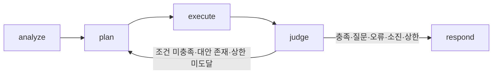

# Agent 설계

## 실행 그래프

| 단계 | 입력 | 처리 | 출력 |
|---|---|---|---|
| analyze | message, 세션 Memory, 선택 장소 snapshot | 명확한 요청은 규칙 분석, 복잡한 요청은 LLM JSON 분석 및 Pydantic 검증. 명시한 조건만 갱신 | intent, conditions, selected_tools, question, analysis_updates |
| plan | 분석·기존 결과·replans | 필수 인자 누락 시 질문. 영화 후보 코드→상세 의존, 3개씩 평가. 주변 장소 anchor 선택 | work_plan/tasks, 의존 인자 |
| execute | tasks | 등록 Tool만 실행, 출력 계약 검증, 동일 이름/인자 결과 재사용, 개별 실패 수집 | candidates/details/cinemas/showtimes/places/errors/cache |
| judge | 조건·조회 결과 | 필요 시간=러닝타임+명시 여유 시간. 실제 회차는 종료 시각+여유와 제한 비교 | recommendations/excluded, replan 여부, stop_reason |
| respond | 최종 상태 | 카드 데이터·필요 질문·중단 안내, Memory 갱신 | ChatOut, events, session_id, run_id |

재계획은 미평가 후보가 남고 조건을 충족한 후보가 없을 때만 한다. 환경변수 MAX_REPLANS는 0~3으로 제한한다. 최대 3번 돌아가 최초 포함 4묶음을 평가한다. 후보 소진·공통 인증 실패·상한 도달은 중단 사유를 남긴다. 추천 상한 안내는 notice로 화면에 보인다. 시간표는 공급자별 부분 성공을 보존하고 실패를 ‘상영 없음’으로 바꾸지 않는다.

## LLM과 코드의 역할

명확한 작품/출연자 확인, 시간표/장소 요청, 명시적인 단순 박스오피스 조회는 규칙으로 처리한다. 그 밖의 자연어는 OpenAI 호환 chat/completions를 호출한다. LLM에는 Tool 이름·사용 시점·입력 스키마, 조건 스키마와 대화 요약을 전달한다. 반환 intent/conditions/tool_names를 검증하며 등록되지 않은 Tool과 인자를 실행하지 않는다. 시간 계산, 조회, 캐시, 반복 상한, DB 저장은 코드가 담당한다. 로깅 Agent는 LLM을 호출하지 않는다.

## 메인/로깅 Agent 관계

메인 Agent → EventBus.emit → 독립 LoggingAgent 구독 → SQLite events. 발행 시점에 event_id/session_id/run_id/type/timestamp/data를 구성한다. 이벤트는 stage_start/stage_end, llm_decision, work_plan, tool_request/tool_response/tool_cache, constraint_result, replan이다. Tool 결과·소요 시간, 단계 실패 종료, 간결한 판단 근거를 기록한다. 내부 추론 원문이나 비밀 키는 기록하지 않는다.

구독자가 없거나 실패해도 메인 처리와 이벤트 반환은 계속된다. 이벤트는 순서를 유지하며 세션 단위 조회·삭제만 가능하다. 저장 실패는 사용자 결과를 실패로 바꾸지 않는다. logger-isolation.json과 단위 테스트에서 분리 실행을 확인한다.

## Memory

SQLite sessions에 세션별 조건, 직전 발화/답변 제한 요약, active_intent, pending_field/time/movie candidates, 직전 추천 식별자와 선택한 장소를 보관한다. 후속 입력에 명시된 필드만 병합하며 null은 해제이다. ‘다른 영화’는 이전 작품 고정을 해제하되 나머지 조건은 유지한다. 인사/질문 후에도 날짜·오후·작품 맥락이 남는다. 클라이언트의 course snapshot은 전체 교체하여 삭제한 장소 anchor가 되살아나지 않게 한다. 원본 외부 응답은 대화 Memory에 넣지 않는다. 전체 이벤트 저장과 요약 Memory는 별도다.

브라우저 localStorage는 자유 일정 초안만, sessionStorage는 대화 세션 ID/검색 맥락을 보관한다. 새 대화는 검색 맥락을 새로 시작하고 일정은 유지한다. 사용자 확정 저장은 별도 API이며 Agent가 임의 저장하지 않는다.

## 파일 구성

app/agent.py 그래프, app/llm.py 분석, *_request.py 규칙, tools_start.py 레지스트리, app/events.py 이벤트/로깅, app/store.py DB, app/itineraries.py 자유 일정, app/api/*.py HTTP, index.html 화면, serve_frontend.py 별도 정적 서버. 선택 심화 Planner/Worker/RAG/Calendar는 적용하지 않았다.
